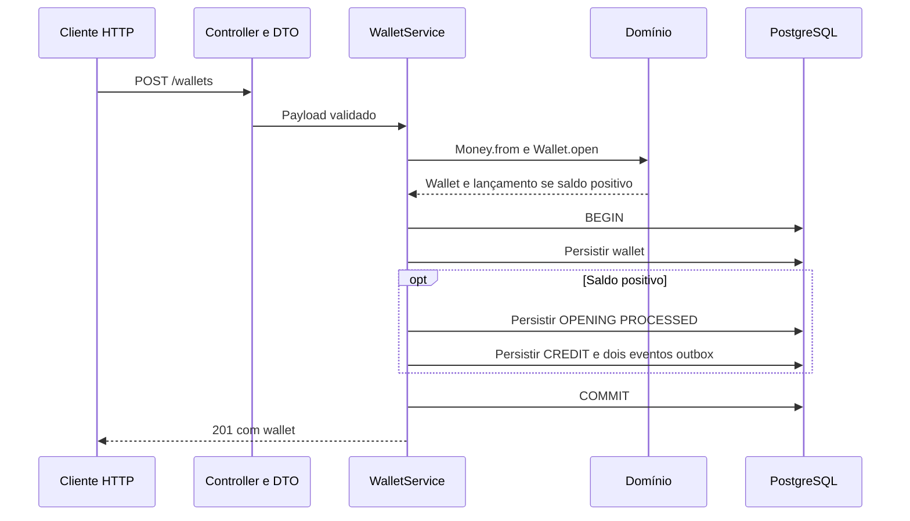

# Arquitetura

Este documento descreve a implementação atual. Os requisitos estão no [enunciado](README_TECHNICAL_CHALLENGE.md), e a cobertura e as pendências, em [PROGRESS](PROGRESS.md). O [glossário](GLOSSARY.md) define os termos do domínio. Os ADRs vinculados abaixo registram decisões e alternativas.

## Mapa do código

| Área | Arquivos | Responsabilidade |
|---|---|---|
| Bootstrap | `src/main.ts` | Inicializa ORM/HTTP; fecha aplicação e pool em sinais ou falha de startup |
| Criação da aplicação | `src/create-application.ts` | Recebe ORM do chamador e cria aplicação Nest |
| Composição | `src/app.module.ts`, `src/{wallets,wagering}/*.module.ts` | Módulo raiz compõe funcionalidades; cada módulo registra controller e serviço |
| Transporte | `src/wallets/wallet.controller.ts`, `src/wallets/*dto.ts` | Wallets, reconciliação e métrica Prometheus; validação estrutural |
| Erros compartilhados | `src/shared/domain-error.filter.ts` | Tradução global de erros conhecidos, registrada uma vez pelo módulo raiz |
| Caso de uso e leitura | `src/wallets/wallet-service.ts` | Abertura atômica, reidratação, ledger keyset e reconciliação em snapshot único |
| Submissão de BET | `src/wagering/` | Contrato HTTP, lock da wallet, débito/rejeição e persistência atômica |
| Domínio | `src/domain/` | Money, Wallet, WagerTransaction, WalletLedgerEntry e eventos; sem NestJS/ORM |
| Persistência | `src/persistence/persistence.module.ts`, `*record.ts`, `config.ts` | Provider MikroORM exportado explicitamente, EntitySchema e configuração |
| Schema | `src/persistence/migrations/` | Constraints, FKs, trigger append-only e índices versionados |
| Verificação | `tests/domain/`, `tests/integration/` | Invariantes, constraints, atomicidade e fronteira HTTP com PostgreSQL real |

## Composição e injeção

`createApplication(orm)` monta `AppModule.register(orm)`, que importa `WalletsModule.register(orm)` e `WageringModule.register(orm)`. Ambos importam `PersistenceModule.register(orm)`, que exporta o token `MikroORM`; factories explícitas injetam a mesma instância fornecida pelo chamador. Não há provider global, conexão adicional por funcionalidade, configuração mutável compartilhada ou Repository intermediário. Providers de um módulo pai não ficam automaticamente visíveis nos filhos.

Controller recebe HTTP e delega; DTO valida estrutura; serviço coordena domínio e persistência. `Money`, `Wallet` e `WalletLedgerEntry` mantêm invariantes fora do NestJS, e `EntitySchema` continua separado do domínio. Para quem vem de Laravel: controller e service têm papéis semelhantes, mas módulo Nest declara a composição e a visibilidade de dependências; `WalletService` pode acessar ORM diretamente, sem transformar objetos de domínio em models Eloquent. Esse layout é convenção adotada, não obrigação de diretórios do framework.

Chamador continua dono do ORM: execução inicializa em `main.ts`, testes fornecem seus próprios bancos, e `app.close()` não fecha o pool emprestado. Startup com falha ou SIGINT/SIGTERM fecha HTTP antes do pool; ambos os sinais compartilham o mesmo encerramento para não fechar duas vezes. Falhas de criação Nest são propagadas ao chamador, sem saída forçada antes da limpeza. Migrations continuam explícitas.

Nest Boost 0.4.0 exige export de classe, não aceita objeto `DynamicModule`. `PreviewAppModule` compõe a mesma cadeia sem ORM fornecido; a factory padrão fica em persistência, sem executar `databaseConfig` nem inicializar PostgreSQL durante o preview nativo do Nest. `nest-boost.json` aponta para essa classe; `evaluate` permanece desativado. Essa entrada é somente para inspeção: execução e testes usam `createApplication(orm)`. Inspeção de DI não substitui HTTP real com PostgreSQL.

O [ADR-0006](docs/adr/0006-organizacao-modular-nest.md) registra a decisão e as alternativas. Os contratos financeiros e o ponto de teste permanecem os mesmos; a reorganização não adiciona testes de wiring.

## Abertura de wallet

Falha antes do commit desfaz todas as escritas. `persist(...).flush()` envia SQL dentro da transação, não antecipa commit. Abertura zero persiste somente wallet; ambas começam em versão 1. OPENING é interna, sem IDs fictícios de provedor, rodada ou jogo, e nasce persistida como PROCESSED.

A constraint única `(player_id, currency)` resolve aberturas concorrentes no PostgreSQL; duplicatas retornam 409. O reenvio não reproduz o resultado original, e a idempotência de apostas segue pendente. Nenhum publisher consome a outbox neste estágio.

## Garantias e limites

- Dinheiro: centavos `bigint` no domínio; `numeric(30,2)` na persistência, lido como string. Limite SQL: 28 dígitos inteiros; overflow falha sem commit parcial. Nunca converter dinheiro para `number`.
- Domínio encapsula estado; factories criam e `rehydrate` reconstrói sem reaplicar transições. Validação HTTP não substitui invariantes do domínio.
- Banco protege saldo não negativo, unicidade, aritmética do ledger e consistência de identidade/moeda por FKs compostas. Trigger rejeita UPDATE, DELETE e TRUNCATE do ledger. Administrador capaz de remover trigger/schema não está contido por essa proteção.
- Correspondência saldo/ledger depende do caso de uso transacional; schema não promete impedir toda escrita administrativa arbitrária. Separação entre usuário de migrations e aplicação ainda é necessária antes de exposição real.
- Sem lock global. BET usa lock pessimista da wallet antes da leitura do saldo. Teste disputa saldo entre duas APIs com pools independentes; três processos financeiros e demais operações continuam pendentes.
- Eventos persistidos: `WagerTransactionProcessed`, `WagerTransactionRejected` e `WalletBalanceChanged`, com envelope versionado e MoneyProps. Persistência não comprova publicação, retry ou recuperação de publisher.

## Processamento de BET

`POST /wagering/transactions` aceita somente BET e exige `Idempotency-Key`. OPENING continua interna; demais kinds ainda são rejeitados. UUIDs são normalizados para minúsculas. Identificadores textuais têm até 200 caracteres, sem espaços nas extremidades ou controles; provider `internal` é reservado. Valor deve ser positivo, com duas casas e até 28 dígitos inteiros.

`WageringService.submit` usa um EntityManager novo por chamada e `transactional`. A primeira leitura da wallet usa `PESSIMISTIC_WRITE` (`SELECT … FOR UPDATE`). O lock dura até commit/rollback; a próxima aposta na mesma wallet espera e lê o saldo confirmado pela anterior. Wallets diferentes não compartilham lock financeiro. Alternativa: versão otimista com retry limitado; descartada neste incremento para evitar repetição do caso de uso após conflito.

O serviço valida player e moeda contra a wallet carregada antes de escrever. Provider tem validação de formato e nome reservado, não autenticação nem cadastro. A API permanece local e sem IdP.

Com saldo suficiente, `Wallet.debit` retorna nova wallet imutável com versão incrementada. SQL confirma BET PROCESSED, saldo observado, um DEBIT, saldo materializado e eventos Processed/BalanceChanged juntos. Sem saldo, confirma BET REJECTED com `INSUFFICIENT_FUNDS` e evento Rejected; saldo, versão e ledger não mudam. Resposta sai após commit. Falha ao gravar qualquer evento desfaz também escritas anteriores. Não há publisher.

`WagerTransaction.create` nasce PENDING; `markProcessed` e `reject` levam a estados terminais, que recusam novas transições. `rehydrate` recompõe estado sem repetir regras. Banco armazena somente estados terminais deste fluxo e exige código de falha apenas na rejeição.

Migration 004 mantém uma OPENING por wallet por índice único parcial. Unicidades de `(provider_id, external_transaction_id)` e `idempotency_key` impedem segundo efeito financeiro, inclusive se a tentativa falhar depois de alterar o saldo dentro da transação. Somente essas duas violações viram 409 `TRANSACTION_ALREADY_EXISTS`; outra unicidade é erro inesperado. O saldo observado fica persistido.

Reenvio ainda retorna conflito, não resultado original. JSON canônico, hash, comparação de payload e replay pertencem ao ticket 06. FKs compostas, checks de não-negatividade e trigger append-only permanecem ativos. `down` da migration 004 recusa execução com BET persistida, antes de remover colunas ou constraints.

Referências consultadas: [MikroORM 6.6 — transações e locks](https://mikro-orm.io/docs/6.6/transactions) e [PostgreSQL 17 — row locks](https://www.postgresql.org/docs/17/explicit-locking.html#LOCKING-ROWS). Evidências e limites: [verificação de BET](docs/verification.md#bet-por-http--2026-10-22).

## Consultas e paginação

Wallet é lida por ID e reidratada. Ledger verifica existência da wallet e lê por `(created_at, id)` crescente. Cursor base64url canônico aponta para lançamento persistido da mesma wallet; PostgreSQL compara timestamp integral, sem passagem por `Date` para retomar página. Resposta preserva timestamp textual com offset e precisão disponível.

Keyset evita deslocamento de linhas existentes, sem manter um snapshot entre consultas. Linhas novas posteriores à âncora podem aparecer; inserções retroativas anteriores exigem nova travessia. O cursor é opaco, mas não é secreto nem funciona como credencial ou mecanismo de autorização. Contrato detalhado e exemplos: [Postman](docs/postman/README.md).

## Reconciliação

Decisão adotada no ticket 04 (§9): um único SELECT parametrizado lê wallet e soma assinada de todo ledger via agregação lateral. CREDIT soma, DEBIT subtrai; histórico vazio vale `0.00`. `numeric` preserva escala e precisão; soma não é limitada novamente a numeric(30,2). Strings monetárias nunca passam por `number`. `difference = storedBalance - calculatedBalance`, podendo ser negativa; `checkedEntries` conta lançamentos, não transações.

O snapshot de comando em READ COMMITTED vê saldo e ledger no mesmo instante, sem bloquear escritor. Uma movimentação atômica concorrente aparece inteira ou não aparece. Alternativa: duas leituras em REPEATABLE READ; descartada por adicionar transação sem benefício para uma única consulta. Duas leituras em READ COMMITTED seriam incorretas. Resultado é diagnóstico daquele instante, não reserva nem garantia sobre escrita posterior.

Nenhuma correção automática, mudança de versão ou escrita financeira. Cada divergência emite mensagem JSON `WalletReconciliationDivergence` via Logger Nest, apenas com walletId, sem saldos, player ou payload; envelope de saída segue logger configurado. Incrementa contador Prometheus sem labels, exposto em GET /metrics no mesmo módulo. Contador por processo, cumulativo por chamada, não persistente e não usado como garantia financeira; coletor deve agregar instâncias e tratar resets. Observabilidade global do §12 permanece pendente.

Teste HTTP com PostgreSQL real cobre zero, abertura além de Number.MAX_SAFE_INTEGER, duas direções de diferença, ausência de reparo, log, contador e transação concorrente parada entre alteração de saldo e inclusão de ledger. Fixture crédito/débito é sintética e isolada, não implementação de BET. Evidências: [verificação](docs/verification.md#reconciliação--2026-10-22).

Referência consultada via Context7: [PostgreSQL 17 — READ COMMITTED](https://www.postgresql.org/docs/17/transaction-iso.html#XACT-READ-COMMITTED), snapshot por comando.

## Falhas HTTP

| Status | Códigos / comportamento |
|---|---|
| 400 | `INVALID_WALLET_PAYLOAD`, `INVALID_IDENTITY`, `INVALID_AMOUNT`, `INVALID_CURRENCY`, `INITIAL_BALANCE_NEGATIVE`, `INVALID_LEDGER_QUERY`; BET: `INVALID_TRANSACTION_PAYLOAD`, `INVALID_TRANSACTION_KIND`, `INVALID_IDEMPOTENCY_KEY`, `INVALID_PROVIDER`, `PLAYER_WALLET_MISMATCH`, `CURRENCY_MISMATCH` |
| 404 | `WALLET_NOT_FOUND` |
| 409 | `WALLET_ALREADY_EXISTS`, `TRANSACTION_ALREADY_EXISTS` |
| 422 | BET persistida REJECTED com `failureCode: "INSUFFICIENT_FUNDS"`, transactionId, saldo observado e idempotentReplay false |
| 503 | BET: `TEMPORARY_UNAVAILABLE` para códigos conhecidos de conexão, shutdown, serialização, deadlock ou timeout/indisponibilidade de lock; sem retry automático |
| 500 | Falha inesperada: resposta genérica do NestJS, sem SQL/credenciais |

Erros conhecidos retornam `{ "code": "..." }`, exceto a rejeição 422, que retorna o resultado financeiro auditado. BET processada retorna 201. DTO rejeita campos extras, estruturas inválidas e dinheiro não textual, sem conversão implícita; falha estrutural precede formato. JSON malformado na submissão recebe `INVALID_TRANSACTION_PAYLOAD`. Falhas inesperadas não viram 400/409. Aceite pendente ainda não existe nesta entrega.

## Decisões

[DECISIONS](DECISIONS.md) relaciona as decisões aos requisitos. As decisões D-001 a D-005 estão registradas nos ADRs 0001 a 0005, com os mesmos status e limites. O [ADR-0006](docs/adr/0006-organizacao-modular-nest.md) registra a organização modular adotada. Os ADRs reúnem justificativas, alternativas e consequências.

## Ainda não entregue

WIN, LOSS, reversões, referências fora de ordem, replay persistente e hash canônico, inbox/SQS, publishers concorrentes, retry/DLQ, health e observabilidade dos demais fluxos permanecem em [PROGRESS](PROGRESS.md). Não há promessa de transições ou falhas desses fluxos no comportamento atual.

API é local e sem autenticação. Decisão final de omissão/IdP e ponto de extensão exigidos pelo enunciado ainda pendentes; bind em loopback não os substitui. Shutdown atual fecha HTTP e ORM, sem consumer, ack ou tratamento de visibilidade.

Setup, migrations e riscos de reversão: [README](README.md). Resultados executados e limites das provas: [evidências](docs/verification.md).

## Referências consultadas

- [MikroORM 6.6 EntitySchema](https://mikro-orm.io/docs/6.6/entity-schema): mapeamento sem decorators no domínio.
- [MikroORM 6.6 migrations](https://mikro-orm.io/docs/6.6/migrations): execução programática e reversão.
- [NestJS controllers](https://docs.nestjs.com/controllers): rotas, serialização e códigos padrão 201/200; implementação usa APIs presentes em 11.1.16.
- [Bun/NestJS metadata](https://github.com/oven-sh/bun/blob/main/test/integration/nest/nest_metadata.test.ts): suporte a decorators; compatibilidade com Bun 1.3.14 comprovada executando HTTP real, não inferida do branch main.
- [MikroORM 6.6 transações](https://mikro-orm.io/docs/6.6/transactions): transação explícita inclui Unit of Work e SQL customizado; flush interno não antecipa commit externo.
- [PostgreSQL 17 constraints](https://www.postgresql.org/docs/17/ddl-constraints.html): CHECK para aritmética local, UNIQUE e FKs para relações.
- [PostgreSQL 17 trigger functions](https://www.postgresql.org/docs/17/plpgsql-trigger.html): exceção aborta UPDATE/DELETE/TRUNCATE de auditoria.
- [NestJS validation](https://docs.nestjs.com/techniques/validation): DTOs, whitelist, `exceptionFactory` e rejeição de campos extras; APIs verificadas com NestJS 11.1.16.
- [NestJS exception filters](https://docs.nestjs.com/exception-filters): filtro centralizado com `BaseExceptionFilter` preserva tratamento genérico de falhas inesperadas.
- [Bun Docker](https://bun.sh/guides/ecosystem/docker): imagem oficial, instalação com lockfile e execução do código-fonte; projeto fixa versão em vez da tag genérica do exemplo.
- [MikroORM 6.6 Unit of Work](https://mikro-orm.io/docs/6.6/unit-of-work): persistência e flush não substituem fronteira transacional.
- [NestJS validation](https://docs.nestjs.com/techniques/validation): consulta via Context7 para `ValidationPipe`, whitelist e `exceptionFactory`; compatibilidade comprovada no NestJS 11.1.16 por HTTP real. Nest Boost MCP inspecionou rotas e DI existentes e confirmou nova rota em processo novo; servidor persistente anterior manteve snapshot antigo.
- [NestJS modules](https://docs.nestjs.com/modules) e [dynamic modules](https://docs.nestjs.com/fundamentals/dynamic-modules): imports/exports explícitos e metadata dinâmica que estende, não substitui, metadata estática; consulta via Context7 orientou a composição, sem duplicar imports estáticos/dinâmicos da funcionalidade.