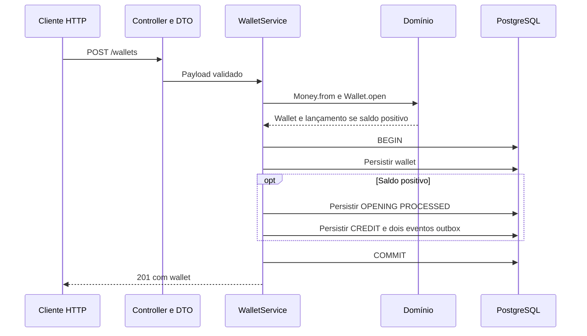

# Arquitetura

Este documento descreve a implementação atual. Os requisitos estão no [enunciado](README_TECHNICAL_CHALLENGE.md), e a cobertura e as pendências, em [PROGRESS](PROGRESS.md). O [glossário](GLOSSARY.md) define os termos do domínio. Os ADRs vinculados abaixo registram decisões e alternativas.

## Mapa do código

| Área | Arquivos | Responsabilidade |
|---|---|---|
| Bootstrap | `src/main.ts` | Inicializa ORM/HTTP; fecha aplicação e pool em sinais ou falha de startup |
| Criação da aplicação | `src/create-application.ts` | Recebe ORM do chamador e cria aplicação Nest |
| Composição | `src/app.module.ts`, `src/{wallets,wagering,outbox}/*.module.ts` | Módulo raiz compõe funcionalidades; módulos declaram providers e controllers aplicáveis |
| Transporte | `src/wallets/wallet.controller.ts`, `src/wallets/*dto.ts` | Wallets e reconciliação; validação estrutural |
| Autenticação | `src/auth/auth.module.ts` | Guard global JWT (JWKS do Keycloak), `@Public()` e checagem de `providerId` |
| Métricas | `src/metrics/` | Registro Prometheus em processo, gauges lidos do PostgreSQL e `GET /metrics` |
| Erros compartilhados | `src/shared/domain-error.filter.ts` | Tradução global de erros conhecidos, registrada uma vez pelo módulo raiz |
| Caso de uso e leitura | `src/wallets/wallet-service.ts` | Abertura atômica, reidratação, ledger keyset e reconciliação em snapshot único |
| Submissão e liquidação | `src/wagering/wagering-service.ts` | Transação SQL, lock da wallet, operações, resolução individual de referências e replay financeiro |
| Consulta de transações | `src/wagering/wagering-queries.ts` | Busca por ID interno ou identidade externa e projeção da resposta |
| Inbox | `src/wagering/wagering-inbox.ts` | Reserva, replay de transporte e checkpoint no EntityManager transacional recebido |
| Referências pendentes | `src/wagering/pending-reference-batch-runner.ts`, `pending-reference-worker.ts` | Varredura paginada, contabilização por candidato e agendamento |
| Consumo de BET SQS | `src/wagering/wager-consumer.ts`, `wager-message.ts` | Envelope, chamada ao caso de uso com contexto de inbox, ack após commit, retry e DLQ |
| Domínio | `src/domain/` | Money, Wallet, WagerTransaction, WalletLedgerEntry, InboxMessage e eventos; sem NestJS/ORM |
| Persistência | `src/persistence/persistence.module.ts`, `*record.ts`, `config.ts` | Provider MikroORM exportado explicitamente, EntitySchema e configuração |
| Schema | `src/persistence/migrations/` | Constraints, FKs, trigger append-only e índices versionados |
| Verificação | `tests/domain/`, `tests/integration/` | Invariantes, constraints, atomicidade e fronteira HTTP com PostgreSQL real |

## Composição e injeção

`createApplication(orm)` monta `AppModule.register(orm)`, que importa `WalletsModule.register(orm)`, `WageringModule.register(orm)` e `OutboxModule.register(orm)`. Os módulos importam `PersistenceModule.register(orm)`, que exporta o token `MikroORM`; factories explícitas injetam a mesma instância fornecida pelo chamador. Não há provider global, conexão adicional por funcionalidade, configuração mutável compartilhada ou Repository intermediário. Providers de um módulo pai não ficam automaticamente visíveis nos filhos.

Controller recebe HTTP e delega; DTO valida estrutura; serviço coordena domínio e persistência. `Money`, `Wallet` e `WalletLedgerEntry` mantêm invariantes fora do NestJS, e `EntitySchema` continua separado do domínio. Para quem vem de Laravel: controller e service têm papéis semelhantes, mas módulo Nest declara a composição e a visibilidade de dependências; `WalletService` pode acessar ORM diretamente, sem transformar objetos de domínio em models Eloquent. Esse layout é convenção adotada, não obrigação de diretórios do framework.

`WageringModule` registra consulta, inbox e varredura como providers separados. `WageringService` continua coordenando submissão, resolução individual e liquidação compartilhada. Ele abre a transação SQL e passa o mesmo EntityManager a `WageringInbox.run`; a inbox não recebe ORM, não cria fork, não abre transação e não confirma escritas por conta própria. Wallet, transação financeira, ledger, inbox quando aplicável e outbox continuam no mesmo commit. A recuperação de uma corrida de unicidade primeiro aborta a tentativa inteira e depois confirma replay e inbox juntos em nova transação. Consulta e varredura têm seus próprios forks de leitura; cada candidato do lote delega a resolução transacional ao serviço. Essa separação mantém as decisões dos ADRs 0006 e 0007, sem Repository pass-through ou transação distribuída.

Chamador continua dono do ORM: execução inicializa em `main.ts`, testes fornecem seus próprios bancos, e `app.close()` não fecha o pool emprestado. Startup com falha ou SIGINT/SIGTERM fecha HTTP antes do pool; ambos os sinais compartilham o mesmo encerramento para não fechar duas vezes. Falhas de criação Nest são propagadas ao chamador, sem saída forçada antes da limpeza. Migrations continuam explícitas.

Nest Boost 0.4.0 exige export de classe, não aceita objeto `DynamicModule`. `PreviewAppModule` compõe a mesma cadeia sem ORM fornecido; a factory padrão fica em persistência, sem executar `databaseConfig` nem inicializar PostgreSQL durante o preview nativo do Nest. `nest-boost.json` aponta para essa classe; `evaluate` permanece desativado. Essa entrada é somente para inspeção: execução e testes usam `createApplication(orm)`. Inspeção de DI não substitui HTTP real com PostgreSQL.

O [ADR-0006](docs/adr/0006-organizacao-modular-nest.md) registra a decisão e as alternativas. Os contratos financeiros e o ponto de teste permanecem os mesmos; a reorganização não adiciona testes de wiring.

## Abertura de wallet

Falha antes do commit desfaz todas as escritas. `persist(...).flush()` envia SQL dentro da transação, não antecipa commit. Abertura zero persiste somente wallet; ambas começam em versão 1. OPENING é interna, sem IDs fictícios de provedor, rodada ou jogo, e nasce persistida como PROCESSED.

A constraint única `(player_id, currency)` resolve aberturas concorrentes no PostgreSQL; duplicatas retornam 409. Abertura não reproduz resultado original; BET usa o replay descrito abaixo. O publisher consome a outbox após o commit, conforme a seção de publicação abaixo.

## Publicação da outbox

`OutboxModule` injeta o ORM existente e um `SQSClient` v3 no `OutboxPublisher`. `main.ts` inicia as varreduras após abrir HTTP. Encerramento espera a execução em andamento antes de fechar o ORM; `app.close()` também para o publisher e destrói o cliente SQS.

A produção e a publicação usam a mesma classe de domínio. `OutboxMessage.enqueue(event)` deriva `id`, `aggregateId`, `eventType`, `payload` e `occurredAt` do evento de integração, então o call site não remonta o envelope; `toOutboxRecord` converte o objeto para o registro do ORM. `OutboxMessage` não abre transação, não faz lock e não conhece SQS nem MikroORM: recebe `now` em `isDue`, `scheduleRetry` e `markPublished`, o que deixa o backoff verificável com relógio fixo. `rehydrate` reconstrói a linha persistida sem reaplicar transição, e `publishedAt` preenchido é terminal; retry ou nova publicação lançam `INVALID_OUTBOX_STATE`.

Cada varredura tenta até 100 registros, com uma transação SQL por evento. `SELECT ... FOR UPDATE SKIP LOCKED` escolhe a primeira linha com `published_at IS NULL` e agenda vencida (ou ausente), ordenada por `occurred_at, id`. Outra conexão não enxerga eventos ainda sem commit. O publisher envia `payload` como JSON sem reconstruir identidade, valores ou datas, e só depois de `SendMessage` retornar atualiza `published_at` com o relógio do banco. Falha SQL desfaz a transação do publisher; o evento conserva seu estado anterior. O lock pertence à linha de outbox, sem bloquear wallet ou manter aberta a transação financeira.

A fila de integração é standard, criada no LocalStack pelo Compose. O SDK faz uma tentativa por envio (`maxAttempts: 1`), com abort após cinco segundos. O próximo ciclo ocorre um segundo após o anterior terminar. Falha de envio incrementa `attempts` e persiste `next_attempt_at` na mesma transação que detém o lock. `scheduleRetry` aplica `min(300, 2^attempts)` segundos: 2, 4, 8, 16, 32, 64, 128, 256 e 300 nas seguintes, com o expoente limitado a 9 antes do cálculo. O instante base é o `clock_timestamp()` lido na consulta que reivindica a linha, e a elegibilidade continua filtrada pelo relógio do PostgreSQL. A contagem registra falhas de envio, continua após sucesso e não limita a recuperação. Não há descarte nem DLQ de saída: indisponibilidade prolongada acumula eventos para envio posterior. Não há jitter neste incremento.

Após agendar o retry, o lote continua sobre outros eventos elegíveis, até 100 tentativas por varredura. Sucesso chama `markPublished`, e a atualização grava `attempts`, `next_attempt_at` e `published_at` a partir do estado do objeto. Erro SQL interrompe o lote. A chamada ao Logger Nest inclui `OutboxPublicationFailed`, tipo do erro e, para falha de envio, `eventId`, sem payload ou credenciais. Também inclui `correlationId`, `transactionId`, `walletId` e `eventType` lidos do envelope. Sucesso registra `OutboxEventPublished` com os mesmos campos. Reinício lê contagem e agenda do banco, sem antecipar retries futuros. Queda antes de confirmar o agendamento desfaz apenas essa tentativa; a linha continua recuperável.

A migration `20261023000700` adiciona contagem não negativa, agenda finita e índice parcial para pendências. Registros antigos começam com zero falhas e sem prazo, prontos para envio. O down preserva envelopes e marcações, mas remove o histórico de tentativas e a agenda; após novo up, pendências voltam a ser imediatamente elegíveis. Pare publishers durante rollback do schema.

A entrega é at-least-once. Se o SQS aceitar a mensagem e o processo morrer antes do commit da marcação, haverá reenvio do mesmo `eventId`. A agenda não vive em memória: cada claim reidrata a linha, então a queda não deixa estado parcial para trás e a linha volta com `attempts` e `next_attempt_at` anteriores. Os consumidores devem deduplicar por essa identidade. Não há garantia de ordem de entrega; `walletVersion` permite reconhecer a sequência financeira. `SKIP LOCKED` evita disputa da mesma linha durante uma execução. O lock é a reserva: commit, rollback ou fechamento da conexão o libera, sem lease persistido ou tarefa de limpeza. O worker vivo pula a linha reservada e processa outras; uma varredura posterior retoma a linha abandonada. A recuperação depende de o PostgreSQL detectar a conexão encerrada; uma partição de rede pode atrasar essa detecção. O timeout de envio limita a chamada ao SQS, não substitui timeouts de conexão do banco.

O ticket 17 verifica dois processos com locks simultâneos, SIGKILL após envio aceito e antes da marcação, progresso do sobrevivente e reenvio do mesmo envelope. Um consumidor de verificação grava o efeito em tabela com chave primária `event_id`, usando `INSERT ... ON CONFLICT DO NOTHING`: cinco entregas produzem quatro efeitos persistidos. Um consumidor real deve confirmar a deduplicação e seu efeito na mesma transação, antes do ack. A prova não implementa inbox de produção nem garante um limite global de duplicatas da fila standard.

Mantivemos o lock transacional já existente em vez de introduzir claim com prazo: um lease exigiria expiração, renovação e proteção contra um worker antigo ainda ativo. A contrapartida é manter uma conexão/transação durante o envio. Referências consultadas via Context7: [PostgreSQL 17 — SKIP LOCKED para consumidores de fila](https://www.postgresql.org/docs/17/sql-select.html#SQL-FOR-UPDATE-SHARE) e [duração dos locks](https://www.postgresql.org/docs/17/explicit-locking.html#LOCKING-ROWS). Setup e cenário reproduzível no [README](README.md#publicar-e-inspecionar-eventos); resultados na [verificação](docs/verification.md#publishers-concorrentes--2026-10-23).

O envelope existente contém `eventId`, `eventType`, `aggregateId`, `correlationId`, `occurredAt` ISO-8601, `version` e `data` com MoneyProps. `causationId` é opcional e atualmente omitido pelos produtores. `WalletBalanceChanged` inclui wallet, transação, direção, valor, saldos anterior/posterior e versão da wallet. Rejeição produz `WagerTransactionRejected`, sem evento de saldo.

Alternativa descartada: enviar no handler HTTP após o commit, pois uma queda nesse intervalo perderia o evento. Marcar antes de enviar também perderia eventos em caso de erro de rede. Manter o registro só como infraestrutura, com retry em SQL, foi descartado porque qualquer mudança de política exigiria migration ou SQL novo e o estado terminal ficaria sem guarda fora do banco. Manter um lock de outbox durante um envio limitado evita claims com lease neste incremento, ao custo de ocupar uma conexão durante a chamada. Retry somente em memória foi descartado porque reinício perderia a agenda.

Referências consultadas via Context7: [AWS SDK v3](https://github.com/aws/aws-sdk-js-v3), [URLs SQS no LocalStack](https://docs.localstack.cloud/aws/services/sqs/) e [hooks de inicialização](https://docs.localstack.cloud/aws/capabilities/config/initialization-hooks/). Comandos no [README](README.md#publicar-e-inspecionar-eventos); resultados em [verificação](docs/verification.md#publicação-da-outbox--2026-10-23).

## Garantias e limites

- Dinheiro: centavos `bigint` no domínio; `numeric(30,2)` na persistência, lido como string. Limite SQL: 28 dígitos inteiros; overflow falha sem commit parcial. Nunca converter dinheiro para `number`.
- Domínio encapsula estado; factories criam e `rehydrate` reconstrói sem reaplicar transições. Validação HTTP não substitui invariantes do domínio.
- Banco protege saldo não negativo, unicidade, aritmética do ledger e consistência de identidade/moeda por FKs compostas. Trigger rejeita UPDATE, DELETE e TRUNCATE do ledger. Administrador capaz de remover trigger/schema não está contido por essa proteção.
- Correspondência saldo/ledger depende do caso de uso transacional; schema não promete impedir toda escrita administrativa arbitrária. Separação entre usuário de migrations e aplicação ainda é necessária antes de exposição real.
- Sem lock global. BET, WIN, LOSS, REFUND e ROLLBACK usam lock pessimista da wallet antes da leitura do saldo. Concorrência financeira de BET foi exercitada em três processos com pools independentes; isso não comprova os fluxos de mensageria.
- Eventos persistidos: `WagerTransactionProcessed`, `WagerTransactionRejected`, `WalletBalanceChanged` e `WagerTransactionPendingReference`, com envelope versionado e MoneyProps. Publicação real, backoff persistido e provas de crash e concorrência dos publishers estão cobertos nos tickets 15–17.

## Processamento de BET

`POST /wagering/transactions` aceita BET, WIN, LOSS, REFUND e ROLLBACK e exige `Idempotency-Key`. OPENING continua interna. UUIDs são normalizados para minúsculas. Identificadores textuais têm até 200 caracteres, sem espaços nas extremidades ou controles; provider `internal` é reservado. Valor deve ser positivo, com duas casas e até 28 dígitos inteiros.

`externalWagerKinds`, em `src/domain/wager-transaction.ts`, é a lista imutável de kinds externos usada pelo domínio e pelo DTO. `ExternalWagerKind` deriva dessa lista; `WagerKind` acrescenta OPENING para persistência e eventos. Serviço e contratos reutilizam esses tipos. Subconjuntos dos eventos preservam suas restrições, como ausência de LOSS no evento de rejeição e na factory que recebe ledger. Comparações específicas continuam nas regras de negócio. Migrations mantêm listas históricas próprias: importar o contrato atual faria uma migration antiga mudar ao adicionar uma operação.

`WageringService.submit` usa um EntityManager novo por chamada e `transactional`. A primeira leitura da wallet usa `PESSIMISTIC_WRITE` (`SELECT … FOR UPDATE`). O lock dura até commit/rollback; a próxima aposta na mesma wallet espera e lê o saldo confirmado pela anterior. Wallets diferentes não compartilham lock financeiro. Alternativa: versão otimista com retry limitado; descartada neste incremento para evitar repetição do caso de uso após conflito.

O serviço valida player e moeda contra a wallet carregada antes de escrever. Provider tem validação de formato e nome reservado, não autenticação nem cadastro. A API permanece local e sem IdP.

Com saldo suficiente, `Wallet.debit` retorna nova wallet imutável com versão incrementada. SQL confirma BET PROCESSED, saldo observado, um DEBIT, saldo materializado e eventos Processed/BalanceChanged juntos. Sem saldo, confirma BET REJECTED com `INSUFFICIENT_FUNDS` e evento Rejected; saldo, versão e ledger não mudam. Resposta sai após commit. Falha ao gravar qualquer evento desfaz também escritas anteriores. A publicação ocorre no worker separado, após commit.

`WagerTransaction.create` nasce PENDING; `markProcessed`, `reject` e `fail` levam a estados terminais, que recusam novas transições. `rehydrate` recompõe estado sem repetir regras. BET e LOSS persistem somente estados terminais; WIN, REFUND e ROLLBACK também podem persistir PENDING_REFERENCE e FAILED, conforme seções abaixo. `reject` aceita somente códigos comerciais; `fail` grava `PERMANENT_INFRASTRUCTURE_FAILURE` e é o único caminho para `FAILED`.

Migration 004 mantém uma OPENING por wallet por índice único parcial. Unicidades de `(provider_id, external_transaction_id)` e `idempotency_key` impedem segundo efeito financeiro. O saldo observado fica persistido. FKs compostas, checks de não-negatividade e trigger append-only permanecem ativos. `down` da migration 004 recusa execução com BET persistida, antes de remover colunas ou constraints.

## Idempotência de BET

Chave do header é obrigatória, global e sensível a maiúsculas; não é derivada automaticamente do payload. Identidade externa é única por `(providerId, externalTransactionId)`, também sensível a maiúsculas, sem escopo por wallet ou rodada. Outra chave para identidade externa existente retorna 409 `TRANSACTION_ALREADY_EXISTS`, mesmo com payload igual; não cria alias. Outro provider pode reutilizar external ID com chave nova.

`payloadHash` é SHA-256 em hexadecimal minúsculo dos bytes UTF-8 de JSON compacto. Campos aparecem nesta ordem lexicográfica: `externalTransactionId`, `gameId`, `kind`, `money`, `playerId`, `providerId`, `referenceExternalTransactionId` quando informada, `roundId`, `walletId`; dentro de `money`: `amount`, `currency`. Omitir referência omite também a propriedade no hash, preservando hashes das BETs existentes. UUIDs usam minúsculas e valor monetário usa duas casas. Strings seguem escaping de `JSON.stringify`, sem normalização Unicode. Espaços e ordem das propriedades no JSON recebido não entram no hash. Header, chave, IDs internos, timestamps e demais metadados HTTP ficam fora; campos extras no body continuam inválidos.

Resultado e hash são gravados junto de saldo, ledger e outbox. Antes de procurar wallet, o serviço consulta a chave persistida: hash diferente retorna `IDEMPOTENCY_CONFLICT`; hash igual retorna transactionId, status, failureCode e saldo observado originais, com `idempotentReplay: true`. Rejeição continua 422 no replay, sem reavaliar saldo. Replay de sucesso continua 201. Nenhum replay altera versão ou produz eventos.

Consulta inicial é otimização, não garantia de exclusão. Se duas instâncias não encontrarem a chave, constraints arbitram a corrida. Após rollback de qualquer uma das duas unicidades conhecidas, um EntityManager novo consulta a chave: se existir, compara hash e reproduz resultado; caso contrário, responde conflito externo. Isso evita depender da ordem em que o PostgreSQL verifica índices. Conflito de chave precede conflito externo; após validação estrutural e de domínio, também precede validação da wallet. Outra violação de unicidade continua erro inesperado.

Migration 005 (`20261023000100`) preenche hashes de BETs existentes a partir dos campos persistidos e exige hash de 64 caracteres hexadecimais em BET, nulo em OPENING. Reversão remove apenas coluna/check, sem apagar auditoria. Migração exige APIs paradas. Alternativa descartada: cache em memória, que não cobre reinício nem múltiplas instâncias; não foi criada tabela de reservas porque BET termina na mesma transação financeira.

Referência consultada para rollback, locks e novo EntityManager: [MikroORM 6.6 — transações](https://mikro-orm.io/docs/6.6/transactions). Evidências e limites atuais: [verificação de idempotência](docs/verification.md#idempotência-de-bet--2026-10-23); histórico do débito: [BET HTTP](docs/verification.md#bet-por-http--2026-10-22).

### Concorrência entre processos

Ticket 08 mantém a estratégia financeira existente, sem migration ou lock em memória. `tests/integration/wallet-concurrency.test.ts` inicia três processos Bun com portas dinâmicas e pools separados. A fixture obtém `WageringService` pelo container Nest; metade dos 50 envios entra por HTTP e metade chama `submit` por IPC. São chamadas ao mesmo caso de uso, não um consumidor SQS.

Uma transação de controle segura a linha da wallet antes do lote. O teste identifica cada processo por `application_name` e aguarda três nomes distintos com `pg_blocking_pids` não vazio. Contar somente esperas diretamente ligadas ao PID controlador seria incorreto: PostgreSQL pode enfileirar uma espera atrás de outra. O prazo de cinco segundos limita a falha da barreira, não define quando há concorrência.

Outro cenário mantém uma wallet bloqueada e confirma duas BET em wallets distintas nos outros processos antes de liberar o lock. Depois reconcilia todas. Não há benchmark: uma hot wallet continua serializada até o fim da transação, e suas chamadas podem ocupar conexões do pool. Mais instâncias não eliminam essa contenção.

Falha antes do commit desfaz a transação e libera o lock; depois do commit, resultado, saldo, ledger e outbox já estão persistidos. Se a resposta se perder, o reenvio usa resultado original e unicidades do banco, não estado do processo. A prova do ticket 08 não simula morte entre commit e ack. O ticket 18 cobre essa janela no consumidor BET, conforme a seção de consumo pelo SQS; as provas dos publishers estão na seção de publicação da outbox.

Alternativa seria optimistic locking com retry limitado ou update condicionado. A prova multiprocesso não exigiu trocar o lock por linha já adotado. Referências: [PostgreSQL 17 — locks de linha](https://www.postgresql.org/docs/17/explicit-locking.html#LOCKING-ROWS) para duração e escopo; [Bun — IPC](https://bun.sh/docs/runtime/child-process#inter-process-communication-ipc) para comunicação da fixture, consultada via Context7 e exercitada no Bun 1.3.14. Evidências: [verificação do ticket 08](docs/verification.md#concorrência-entre-processos--2026-10-23).

## Crédito de WIN e referências

Decisão D-012, ticket 09 (§6.2–6.4, §7, §9 e §11): WIN reutiliza `WageringService.submit`, a chave global e o lock por wallet do BET. `Wallet.credit` aplica dinheiro exato, e a mesma transação SQL persiste WIN PROCESSED, saldo observado, CREDIT, saldo/versão e eventos Processed/BalanceChanged. Qualquer falha antes do commit desfaz o conjunto. A resposta sai depois do commit; replay lê o resultado persistido, sem creditar novamente.

Mapeamentos monetários usam instância explícita de `StringType` com `columnType: 'numeric(30,2)'`. PostgreSQL continua responsável pela representação numérica exata; ORM compara strings canônicas. O `DecimalType` instalado em 6.6.8 converte para `number` em `compareValues`, e deixou de detectar um crédito de `0.01` sobre `9007199254740993.01` no teste HTTP. Declarar apenas `type: 'string'` ou passar a classe `StringType` não bastou: discovery voltou a inferir DecimalType pela coluna. A instância explícita evita essa substituição, sem tipo monetário customizado nem alteração SQL.

Referência é opcional para WIN. Omissão significa prêmio independente, não referência faltante. Se `referenceExternalTransactionId` estiver presente, deve identificar BET no mesmo provider, player, wallet, moeda e rodada. A busca usa `(providerId, externalTransactionId)`: ID de outro provider não é resolvido por aproximação. WIN não é reversão; prêmio pode diferir do valor da BET e `gameId` não integra a regra de compatibilidade do §7, item 2.

| Referência informada | Resultado | Efeito financeiro |
|---|---|---|
| BET PROCESSED compatível | PROCESSED, HTTP 201 | Um CREDIT e versão incrementada |
| Identidade, moeda, rodada ou kind incompatível | REJECTED, HTTP 422, `REFERENCE_MISMATCH` | Nenhum; evento Rejected |
| BET terminal sem processamento | REJECTED, HTTP 422, `REFERENCE_NOT_PROCESSED` | Nenhum; evento Rejected |
| Não encontrada ou ainda não terminal | PENDING_REFERENCE, HTTP 202 | Nenhum; evento PendingReference |

Validação da wallet precede resolução da referência: player ou moeda incompatível com a própria wallet continua erro 400, sem transação aceita. Referência rejeitada fica auditada como rejeição de negócio, com saldo observado e sem ledger.

PENDING_REFERENCE mantém payload/hash, referência externa e saldo observado no aceite. Não tem `processedAt`; não gera ledger ou BalanceChanged. Replay e GET consultam o registro, sem tentar resolução, mesmo que a BET apareça depois. O worker resolve ou encerra a pendência conforme a [política de referências](#resolução-de-referências-pendentes). Não se deve tratar HTTP 202 como crédito concluído.

Alternativa descartada: ignorar referência opcional informada e creditar antes de validá-la. Isso aceitaria prêmio associado a outra wallet ou rodada. Exigir referência para todo WIN também restringiria o contrato além do enunciado. Publicar diretamente no broker após o crédito deixaria uma janela de perda; o caso de uso grava a outbox e deixa a publicação para o worker separado.

Migration `20261023000200` adiciona WIN, PENDING_REFERENCE, IDs de referência e checks de formato/estado. Uma FK composta liga o ID interno ao provider e ID externo resolvidos; rejeições por incompatibilidade preservam a referência para auditoria. O `down` restaura o contrato BET anterior somente quando não há WIN ou histórico de referência. Caso contrário, recusa a reversão sem apagar dados. Unicidades de chave/identidade externa, FKs financeiras e proteção append-only do ledger permanecem.

Referência consultada: [MikroORM 6.6 — transações e concorrência](https://mikro-orm.io/docs/6.6/transactions), para lock de linha dentro de transação explícita e rollback de flushes anteriores. Evidências executadas ficam em [WIN HTTP](docs/verification.md#win-por-http--2026-10-23).

## LOSS sem movimento

Decisão D-013, ticket 10 (§6.2–6.4, §7 e §11): LOSS reutiliza `WageringService.submit`, lock por wallet, hash e unicidades existentes. O lock fixa o saldo observado em relação às operações concorrentes. Não chama `Wallet.debit` ou `Wallet.credit`, não altera saldo, versão ou `updatedAt`, não cria ledger e não produz `WalletBalanceChanged`.

LOSS nasce PENDING e passa diretamente a PROCESSED. Resultado, saldo observado, `processedAt` e `WagerTransactionProcessed` são confirmados na mesma transação SQL. Transições após PROCESSED lançam `INVALID_TRANSACTION_STATE`, erro de programação; replay ocorre antes de qualquer nova transição. Falha ao inserir outbox desfaz também a transação de aposta. Após commit, reenvio devolve resultado original, mesmo se outra operação já mudou saldo.

Valor continua positivo e segue o contrato monetário comum, mas não exige saldo disponível. Referência não é aceita; LOSS registra resultado independente, sem buscar BET nem impor uma derrota por rodada. Essas restrições adicionais não constam do enunciado. Alternativa descartada: lançamento de valor zero ou novo débito, que alteraria auditoria e versão sem movimento financeiro.

Migration `20261023000300` amplia checks existentes sem relaxar contratos BET/WIN: LOSS exige identidade externa, hash, saldo observado e metadados terminais, sem referência ou failure code. `down` restaura checks anteriores apenas sem histórico LOSS; caso contrário, recusa sem apagar dados. A correspondência saldo/ledger continua sob responsabilidade do caso de uso transacional, não de um trigger novo.

HTTP retorna 201, inclusive no replay; validação e conflitos seguem códigos existentes. Os eventos são publicados pelo worker da outbox; entrada por SQS usa a mesma inbox de BET. Referência consultada: [MikroORM 6.6 — transações](https://mikro-orm.io/docs/6.6/transactions). Resultados executados: [LOSS HTTP](docs/verification.md#loss-por-http--2026-10-23).

## Devolução de BET com REFUND

Decisão D-014, ticket 11 (§6.3, §7, §9 e §11): REFUND exige `referenceExternalTransactionId` e reutiliza resolução por provider/ID externo, lock da wallet, hash e replay existentes. O domínio aceita apenas BET PROCESSED do mesmo provider, player, wallet, moeda e rodada, com valor exatamente igual. `gameId` não integra a compatibilidade exigida no §7. Reversão parcial não é aceita.

Referência incompatível resulta em REJECTED com `REFERENCE_MISMATCH`; BET terminal sem processamento, `REFERENCE_NOT_PROCESSED`. Referência inexistente ou ainda não terminal resulta em PENDING_REFERENCE. Pendência e rejeição persistem saldo observado e evento correspondente, sem ledger, crédito ou incremento de versão. A validação da própria wallet ainda precede a referência: player/moeda divergente da wallet retorna 400 antes de aceitar a transação. Busca não atravessa providers; ID existente apenas em outro provider é referência ausente.

Após validar a referência e ainda sob lock da wallet, o serviço procura REFUND PROCESSED para a mesma BET. Nova tentativa com identidade própria é auditada como REJECTED com `REFERENCE_ALREADY_REFUNDED`. Migration `20261023000400` adiciona índice único parcial `wager_transactions_refund_reference_unique` sobre `reference_transaction_id` somente para REFUND PROCESSED. Essa é a garantia final contra dois créditos; pendências e rejeições não reservam a BET. O lock serializa tentativas válidas da mesma wallet e permite registrar rejeição de negócio, em vez de expor violação de unicidade como erro inesperado.

No sucesso, `Wallet.credit` devolve o valor integral; saldo/versão, REFUND PROCESSED, CREDIT e eventos Processed/BalanceChanged confirmam juntos. Flush não antecipa commit; falha na outbox desfaz inclusive a reserva no índice. Replay mantém identidade, status, failure code e saldo originais, sem consultar novamente a BET ou emitir evento. Replay de pendência não a resolve; o worker segue a [política de referências](#resolução-de-referências-pendentes).

Alternativa descartada: índice único sobre todas as tentativas, que faria uma rejeição por valor inválido impedir devolução válida posterior. Checar apenas no serviço, sem índice, deixaria a unicidade dependente da disciplina dos escritores. Não há lock adicional na BET: uma referência válida pertence à wallet já bloqueada.

Migration amplia os checks de kind, referência obrigatória, hash e metadados de status, sem mudar contratos anteriores. O `down` restaura BET/WIN/LOSS somente sem qualquer histórico REFUND; caso contrário, recusa sem apagar auditoria. Compatibilidade financeira da referência permanece no domínio; schema protege formato, vínculo provider/ID externo e unicidade, não toda escrita administrativa arbitrária.

Referências consultadas: [MikroORM 6.6 — transações e concorrência](https://mikro-orm.io/docs/6.6/transactions), para lock e rollback; [PostgreSQL 17 — índice único parcial](https://www.postgresql.org/docs/17/indexes-partial.html#INDEXES-PARTIAL-EX3), para permitir tentativas rejeitadas sem segundo sucesso. Evidências e limites: [REFUND](docs/verification.md#refund-de-bet--2026-10-23).

## Reversão de movimento com ROLLBACK

Decisão D-015, ticket 12 (§6.3, §7, §9 e §11): ROLLBACK exige referência externa e aceita BET, WIN ou REFUND PROCESSED. O domínio valida provider, identidade externa, player, wallet, moeda, rodada e valor integral. Jogo pode diferir. OPENING, LOSS e ROLLBACK são inelegíveis e resultam em `REFERENCE_MISMATCH`; referência terminal sem processamento resulta em `REFERENCE_NOT_PROCESSED`. Referência ausente ou não terminal fica PENDING_REFERENCE, sem movimento.

`WagerTransaction.ledgerDirectionFor` define a direção: BET é revertida com CREDIT; WIN e REFUND, com DEBIT. A verificação de saldo ocorre sob lock da wallet antes de aplicar o débito. Insuficiência gera REJECTED com `INSUFFICIENT_REVERSAL_FUNDS`, distinto de `INSUFFICIENT_FUNDS` da BET. Rejeição persiste saldo observado e evento Rejected, sem ledger ou incremento de versão.

Após resolver a referência, o serviço procura reversão PROCESSED do mesmo tipo sob o lock existente. Segunda tentativa ROLLBACK recebe `REFERENCE_ALREADY_ROLLED_BACK`. Migration `20261023000500` acrescenta `wager_transactions_rollback_reference_unique`, índice único parcial sobre a referência somente para ROLLBACK PROCESSED. REFUND mantém seu índice separado. As duas operações podem reverter a mesma BET uma vez cada: proibição cruzada ampliaria §7.4 sem base no enunciado. Tentativas rejeitadas ou pendentes não reservam sucesso.

Saldo/versão, ROLLBACK, ledger invertido e eventos Processed/BalanceChanged confirmam na mesma transação SQL. Falha de outbox antes do commit desfaz o conjunto, inclusive a reserva no índice; nova tentativa continua possível. Replay lê status, código e saldo originais, mesmo após reinício, sem reaplicar movimento ou resolver pendência. A resolução agendada reutiliza as mesmas regras na seção abaixo.

O schema amplia checks de kind, referência obrigatória, hash e estados, sem alterar migrations anteriores. Down recusa qualquer histórico ROLLBACK; sem histórico, restaura o contrato REFUND. Compatibilidade financeira continua no domínio; checks/FKs protegem formato e vínculo externo, não toda escrita administrativa arbitrária.

Alternativas descartadas: unicidade de todas as tentativas impediria correção após rejeição; unicidade compartilhada com REFUND proibiria operação permitida; checagem sem índice deixaria a exclusão dependente dos escritores. Não há segundo lock na referência, pois referência elegível pertence à wallet já bloqueada. Fontes: [MikroORM 6.6](https://mikro-orm.io/docs/6.6/transactions) e [PostgreSQL 17](https://www.postgresql.org/docs/17/indexes-partial.html#INDEXES-PARTIAL-EX3). Provas executadas e limites: [verificação](docs/verification.md#rollback-de-movimento--2026-10-23).

## Resolução de referências pendentes

Decisão D-016, tickets 13 e 14 (§6.3, §7.1 e §13): `WageringService.settle` concentra a aplicação financeira usada por `submit` e pela resolução. A resolução reidrata o registro `PENDING_REFERENCE` em vez de criar outra transação e reutiliza validação da referência, exclusão de reversões duplicadas e persistência financeira.

`PendingReferenceWorker` inicia em `src/main.ts` e para em `SIGTERM`/`SIGINT` antes de fechar o ORM. Seu `runOnce` chama `PendingReferenceBatchRunner.run`, que lista apenas pendências com `reference_next_attempt_at <= at`, por `id`, em páginas de `PENDING_REFERENCE_PAGE_SIZE`. O runner chama `WageringService.resolvePendingReference` por candidato e contabiliza processados, rejeitados, pendentes, pulados e falhas; uma falha não interrompe os candidatos ou páginas seguintes. `PENDING_REFERENCE_INTERVAL_MS` controla o agendamento, não substitui o backoff por operação. Não há rota HTTP para disparar a varredura. A resolução individual, `batch.run` e `worker.runOnce` aceitam `Date` opcional; testes fornecem tempo explícito, sem sleeps para simular o backoff.

O corte de elegibilidade é fixo durante a varredura. Em produção, cada tentativa captura seu instante após obter o lock da wallet; espera por lock ou páginas anteriores não antecipa `processedAt` nem o próximo retry. Uma data explícita fixa também esse instante nos testes.

A resolução bloqueia a linha com `PESSIMISTIC_PARTIAL_WRITE` (`FOR UPDATE SKIP LOCKED`) e só segue se continuar pendente e vencida. Depois bloqueia a wallet com `PESSIMISTIC_WRITE`. Workers concorrentes pulam a linha bloqueada ou encontram seu próximo horário adiado/estado terminal. Os índices únicos parciais de REFUND/ROLLBACK e o lock da wallet continuam impedindo dois efeitos para a mesma referência.

### Política de tentativas e encerramento

A submissão inicial persiste `reference_attempts = 0` e `reference_next_attempt_at` igual ao horário do aceite. O primeiro retry fica imediatamente elegível, mas depende da próxima varredura. Cada tentativa vencida do worker incrementa o contador na mesma transação SQL do resultado. Chamada anterior ao horário, linha bloqueada ou status terminal resulta em `SKIPPED`, sem consumir tentativa.

Após a tentativa `n` continuar pendente, para `1 <= n < 10`, o próximo horário é o instante dessa tentativa mais `min(1000 * 2 ** (n - 1), 60000)` milissegundos. Os nove delays são `1, 2, 4, 8, 16, 32, 60, 60, 60` segundos, soma de 243 segundos desde o primeiro retry até a décima tentativa no agendamento ideal. Não é TTL: downtime, contenção, duração e intervalo das varreduras podem alongar esse tempo. Cada tentativa agenda a seguinte a partir de sua própria execução; reinício não dispara todas as tentativas atrasadas de uma vez.

O limite de dez tentativas encerra pendências sem depender da memória do worker. O backoff reduz consultas repetidas, e o teto de 60 segundos mantém novas oportunidades de resolução sem aumentar indefinidamente o intervalo. São valores fixos desta política, não uma promessa de prazo do provedor nem uma medição de carga. Alternativas descartadas: retry ilimitado manteria órfãs para sempre; TTL isolado consumiria a janela durante downtime, mesmo sem tentar a referência.

A resolução sempre consulta e valida a referência antes de verificar esgotamento, inclusive na décima tentativa:

| Situação na tentativa vencida | Resultado | Escritas |
|---|---|---|
| Referência ausente ou não terminal, tentativas 1–9 | Continua `PENDING_REFERENCE` | Contador e próximo horário; sem novo evento `PendingReference` |
| Referência ausente ou não terminal, tentativa 10 | `REJECTED`, `REFERENCE_NOT_FOUND` | Contador 10, saldo observado no término, `processedAt` e `WagerTransactionRejected`; sem ledger |
| Referência `PROCESSED` compatível, inclusive na tentativa 10 | Aplica regras financeiras existentes | Resultado, saldo/versão quando houver movimento, ledger e eventos juntos |
| Referência incompatível | `REJECTED`, `REFERENCE_MISMATCH` | Resultado e evento `Rejected`, sem ledger |
| Referência compatível `REJECTED` ou `FAILED` | `REJECTED`, `REFERENCE_NOT_PROCESSED` | Resultado e evento `Rejected`, sem ledger |
| Erro transitório na tentativa | Continua `PENDING_REFERENCE` | Nenhuma; a tentativa volta a ser elegível |
| Erro permanente na tentativa | `FAILED`, `PERMANENT_INFRASTRUCTURE_FAILURE` | Status, código, `processedAt` e próximo horário nulo; sem saldo, versão, ledger ou evento |
| Ainda não vencida, bloqueada ou já terminal | `SKIPPED` | Nenhuma |

Uma referência existente que nunca sai de estado não terminal também esgota as dez tentativas. Uma referência incompatível continua `REFERENCE_MISMATCH`, mesmo se também estiver rejeitada.

### Falha permanente de infraestrutura

`FAILED` cobre o caso em que a própria resolução não consegue terminar por falha permanente de infraestrutura, e não por uma regra de negócio. A transição `fail(code, at)` parte de `PENDING` ou `PENDING_REFERENCE`, grava `PERMANENT_INFRASTRUCTURE_FAILURE` e `processedAt`, e é terminal. `reject()` continua restrito aos códigos comerciais. Só `WIN`, `REFUND` e `ROLLBACK` com `referenceExternalTransactionId` podem terminar em `FAILED`, porque são os únicos kinds que persistem estado não terminal. BET e LOSS não têm esse caminho; ampliar isso exige mudar domínio e schema juntos.

A classificação reutiliza a lista de códigos transitórios de `submit`: SQLSTATE de conexão, serialização, deadlock, timeout de lock e rede. Esses erros continuam propagando para o runner, e a linha permanece `PENDING_REFERENCE`, elegível para a próxima tentativa. Qualquer outro erro é permanente para este fluxo, incluindo `WALLET_NOT_FOUND`, `INVALID_TRANSACTION_STATE`, violação de constraint e erro de integridade persistida. Um erro transitório que virasse `FAILED` encerraria uma operação que ainda pode ser concluída.

A marcação usa uma transação separada. A tentativa que falhou já sofreu rollback inteiro: resultado, saldo, ledger, outbox e contador voltaram ao estado anterior. Reabrir a linha, reidratar, chamar `fail()` e gravar status, código e `processedAt` numa transação nova é o que torna a falha auditável apesar do rollback. `referenceNextAttemptAt` fica nulo, então a varredura não pega mais a linha. O `observedBalance` persistido no aceite é preservado; não vem da wallet atual, que pode estar justamente indisponível. Nenhum lançamento, mudança de saldo, versão ou evento é gravado. Se a própria marcação falhar, nada é confirmado: a linha continua `PENDING_REFERENCE`, o runner conta erro e uma nova varredura pode tentar de novo. Isso evita `FAILED` falso.

Consulta por ID e por provider/ID externo devolve 200 com `FAILED`, `failureCode`, saldo observado e `processedAt`. O replay devolve 500 com o mesmo corpo terminal, porque é falha permanente de infraestrutura, e não aceite pendente nem rejeição de negócio. Nenhuma submissão nova nasce `FAILED`; o estado só aparece pela resolução. Uma referência `FAILED` consultada por outro WIN, REFUND ou ROLLBACK recebe `REFERENCE_NOT_PROCESSED`.

Migration `20261023000900` inclui `FAILED` no check de status, exige código e `processedAt` no shape terminal e aceita `FAILED` com ou sem `referenceTransactionId`. O `down` recusa quando existe histórico `FAILED`. O gauge `wager_transactions{status}` passa a mostrar essa série, o contador `wager_failed_transactions_total` expõe a marcação por processo e o log `PendingReferenceFailed` leva `correlationId`, `transactionId`, `failureCode` e `errorType`. O contrato de eventos não muda. `FAILED` não publica nada, porque a outbox pode ser justamente a dependência que falhou. Um evento `WagerTransactionFailed` fica como extensão futura.

Alternativa descartada: declarar `FAILED` inalcançável, retirá-lo da matriz e manter só a rejeição de negócio. Isso não atende ao requisito de estado terminal auditável para falha permanente e deixaria a linha em retry até o limite de dez tentativas. Outra alternativa era marcar `FAILED` na mesma transação da tentativa, que seria desfeita pelo rollback.

Replay e GET durante a pendência preservam o saldo observado no aceite e não disparam resolução nem consomem tentativas. No término, `observedBalance` passa a registrar o saldo da wallet sob lock naquele instante, depois do movimento se houver. GET retorna 200; replay retorna 201 no sucesso, 422 na rejeição ou 500 em `FAILED`, com status, código e saldo terminal persistidos, mesmo depois de novas operações ou reinício.

`REFERENCE_NOT_FOUND` é definitivo, inclusive quando significa referência ainda não terminal ao esgotar o limite. O provedor deve corrigir a referência e usar nova identidade externa e chave para uma nova operação; nova chave com a identidade antiga continua conflito. Replay nunca reabre nem credita a transação encerrada se a referência chegar depois.

Status, contador, próximo horário, saldo observado terminal e evento de rejeição confirmam no mesmo commit. Encerramento não altera saldo, versão ou ledger. Falha transitória desfaz todas essas escritas e não consome a tentativa. Falha permanente também desfaz a tentativa, e a transação de marcação separada grava `FAILED` sem mover dinheiro. Reinício retoma contador e próximo horário persistidos; depois do commit, estados terminais deixam a varredura e não repetem efeito ou evento. Publicação da outbox não faz parte do worker.

Migration `20261023000600` adiciona `reference_attempts` de 0 a 10 e `reference_next_attempt_at`, finito e obrigatório apenas em `PENDING_REFERENCE`; pendência exige contador menor que 10. Estados terminais ficam sem próximo horário. Pendências anteriores recebem contador zero e horário `created_at`, sem perda de identidade, hash ou saldo do aceite. O índice parcial `(reference_next_attempt_at, id)` atende à busca de pendências vencidas. `down` recusa histórico com `REFERENCE_NOT_FOUND`; sem esse histórico, remove campos/índice e restaura checks anteriores. Exige APIs paradas.

O publisher envia os eventos ao SQS; todos os kinds externos também entram pela fila com inbox, conforme a seção de consumo abaixo. `FAILED` não gera evento e é lido por consulta, replay, log e métrica. A segurança entre instâncias vem do PostgreSQL, não de scheduler distribuído. Cenários SQL/HTTP não comprovam ack, redelivery ou publicação. Testes focais e setup: [README](README.md#resolver-referência-pendente). Registro de execução do ticket 14: [expiração de referências](docs/verification.md#expiração-de-referências--2026-10-23); resultados devem ser lidos nessa seção, sem extrapolar evidências históricas do ticket 13.

Referências dos locks mantidas da resolução: [MikroORM 6.6 — pessimistic locking](https://mikro-orm.io/docs/6.6/transactions#pessimistic-locking) e [PostgreSQL 17 — row-level locks](https://www.postgresql.org/docs/17/explicit-locking.html#LOCKING-ROWS). Evidências históricas do ticket 13: [resolução de referências](docs/verification.md#resolução-de-referências--2026-10-23).

## Consumo de BET pelo SQS

O [ADR-0007](docs/adr/0007-inbox-atomica-de-bet.md) registra a decisão do ticket 18: o consumidor valida o envelope, reutiliza o DTO HTTP e chama `WageringService.submit` com contexto de inbox. `WageringService` delega reserva, replay de transporte e checkpoint a `WageringInbox.run`, passando o EntityManager da transação financeira. A reserva única por `(consumerName, messageId)` e seu resultado compartilham essa transação; o colaborador não possui conexão ou commit independentes. Replay usa o resultado original; conteúdo divergente para o mesmo ID gera `MESSAGE_ID_CONFLICT` e DLQ. Duplicata de negócio com outro ID confirma uma nova inbox sem segundo débito.

`main.ts` inicia o consumidor e interrompe novas leituras nos sinais de encerramento. Ack acontece após commit; falha na outbox desfaz também a inbox. A política inicial de retry, DLQ, visibilidade e seus limites está no ADR. Setup e envio manual: [README](README.md#enviar-bet-pelo-sqs). Evidências reais, incluindo três processos e crash na janela commit/ack: [verificação](docs/verification.md#bet-por-sqs--2026-10-23).

O ticket 19 amplia o parser para WIN e LOSS sem alterar a transação SQL. WIN credita e emite Processed/BalanceChanged; LOSS emite somente Processed, sem saldo, versão ou ledger novos. Referências e códigos de falha seguem o HTTP. A [extensão do ADR-0007](docs/adr/0007-inbox-atomica-de-bet.md#extensão-no-ticket-19) registra decisão e alternativa; [evidências](docs/verification.md#resultados-por-sqs--2026-10-24) incluem replay persistente e rollback dos dois resultados. O ticket 20 libera REFUND/ROLLBACK pelo DTO compartilhado; [ADR-0007](docs/adr/0007-inbox-atomica-de-bet.md#extensão-no-ticket-20) registra continuidade após ack e replay pendente. O ticket 21 não altera código de produção: queda do PostgreSQL vira `TEMPORARY_UNAVAILABLE`, sem ack, com backoff e DLQ na quinta falha. A [extensão do ADR-0007](docs/adr/0007-inbox-atomica-de-bet.md#extensão-no-ticket-21) registra a política e o [teste com proxy](docs/verification.md#falhas-transitórias-do-consumidor--2026-10-24) demonstra a recuperação. O ticket 22 adiciona à DLQ atributos com causa, tipo de falha, tentativa e identidades; saldo insuficiente segue fora dela ([ADR-0007](docs/adr/0007-inbox-atomica-de-bet.md#extensão-no-ticket-22)). O ticket 23 limita a drenagem do consumidor no shutdown: vencido o prazo, a mensagem sem ack volta à fila ([ADR-0007](docs/adr/0007-inbox-atomica-de-bet.md#extensão-no-ticket-23)).

## Consultas e paginação

Wallet é lida por ID e reidratada. Ledger verifica existência da wallet e lê por `(created_at, id)` crescente. Cursor base64url canônico aponta para lançamento persistido da mesma wallet; PostgreSQL compara timestamp integral, sem passagem por `Date` para retomar página. Resposta preserva timestamp textual com offset e precisão disponível.

Keyset evita deslocamento de linhas existentes, sem manter um snapshot entre consultas. Linhas novas posteriores à âncora podem aparecer; inserções retroativas anteriores exigem nova travessia. O cursor é opaco, mas não é secreto nem funciona como credencial ou mecanismo de autorização. Contrato detalhado e exemplos: [Postman](docs/postman/README.md).

### Consulta de transação

Ambas as rotas GET usam `WageringQueries.get`: um EntityManager novo faz um SELECT por ID interno ou pelo par completo `(providerId, externalTransactionId)`. O índice único existente atende à identidade externa. Nenhum lock financeiro, flush, processamento ou evento é necessário; nenhuma migration foi adicionada.

A projeção explícita preserva identidade, valor/moeda, status, datas e `failureCode` quando presente. Saldo vem de `observedBalance`, não da wallet atual; chave de idempotência e hash não são expostos. UUID aceita maiúsculas e é normalizado; identificadores externos preservam caixa e regras da submissão: até 200 caracteres, sem controles ou espaços nas extremidades, provider `internal` reservado. Identidade ausente retorna `TRANSACTION_NOT_FOUND`; inválida falha antes de consultar.

Consulta de rejeição ou de `FAILED` retorna 200 com resultado persistido; 422 e 500 pertencem à tentativa de processamento. Não há `idempotentReplay` em leitura. OPENING é acessível por ID interno, com metadados externos nulos e sem `balance` quando não há saldo observado persistido. Não são inventados dados de provedor ou saldo histórico.

Alternativa descartada: reconstruir resultado pelo ledger, que não contém lançamentos de rejeições. Ler diretamente a transação também preserva o saldo original após outras apostas e reinício, sem cache local. A leitura vê somente registros confirmados; um 404 não prova que uma submissão concorrente nunca fará commit.

Referência: [NestJS controllers](https://docs.nestjs.com/controllers), consultada via Context7 para `@Get`, `@Param` e status 200; compatibilidade exercitada no NestJS 11.1.16. Evidências: [consulta de transação](docs/verification.md#consulta-de-transação--2026-10-23).

## Reconciliação

Decisão adotada no ticket 04 (§9): um único SELECT parametrizado lê wallet e soma assinada de todo ledger via agregação lateral. CREDIT soma, DEBIT subtrai; histórico vazio vale `0.00`. `numeric` preserva escala e precisão; soma não é limitada novamente a numeric(30,2). Strings monetárias nunca passam por `number`. `difference = storedBalance - calculatedBalance`, podendo ser negativa; `checkedEntries` conta lançamentos, não transações.

O snapshot de comando em READ COMMITTED vê saldo e ledger no mesmo instante, sem bloquear escritor. Uma movimentação atômica concorrente aparece inteira ou não aparece. Alternativa: duas leituras em REPEATABLE READ; descartada por adicionar transação sem benefício para uma única consulta. Duas leituras em READ COMMITTED seriam incorretas. Resultado é diagnóstico daquele instante, não reserva nem garantia sobre escrita posterior.

Nenhuma correção automática, mudança de versão ou escrita financeira. Cada divergência emite mensagem JSON `WalletReconciliationDivergence` via Logger Nest, apenas com walletId, sem saldos, player ou payload; envelope de saída segue logger configurado. Incrementa `wallet_reconciliation_divergences_total`, sem labels, no registro compartilhado descrito em [Métricas](#métricas). Contador por processo, cumulativo por chamada, não persistente e não usado como garantia financeira.

Teste HTTP com PostgreSQL real cobre zero, abertura além de Number.MAX_SAFE_INTEGER, duas direções de diferença, ausência de reparo, log, contador e transação concorrente parada entre alteração de saldo e inclusão de ledger. Fixture crédito/débito é sintética e isolada, não implementação de BET. Evidências: [verificação](docs/verification.md#reconciliação--2026-10-22).

Referência consultada via Context7: [PostgreSQL 17 — READ COMMITTED](https://www.postgresql.org/docs/17/transaction-iso.html#XACT-READ-COMMITTED), snapshot por comando.

## Falhas HTTP

| Status | Códigos / comportamento |
|---|---|
| 401 | `UNAUTHORIZED`: token ausente ou inválido (assinatura, `iss`, `aud`, `exp`, claim `providerId`) |
| 403 | `PROVIDER_IDENTITY_MISMATCH`: `providerId` do token difere do body ou da rota; nada é processado |
| 400 | `INVALID_WALLET_PAYLOAD`, `INVALID_IDENTITY`, `INVALID_AMOUNT`, `INVALID_CURRENCY`, `INITIAL_BALANCE_NEGATIVE`, `INVALID_LEDGER_QUERY`; transações externas: `INVALID_TRANSACTION_PAYLOAD`, `INVALID_TRANSACTION_KIND`, `INVALID_IDEMPOTENCY_KEY`, `INVALID_PROVIDER`, `PLAYER_WALLET_MISMATCH`, `CURRENCY_MISMATCH` |
| 404 | `WALLET_NOT_FOUND`, `TRANSACTION_NOT_FOUND` |
| 409 | `WALLET_ALREADY_EXISTS`, `TRANSACTION_ALREADY_EXISTS`, `IDEMPOTENCY_CONFLICT` |
| 422 | BET/WIN/REFUND/ROLLBACK persistida REJECTED com failureCode, transactionId e saldo observado; `INSUFFICIENT_FUNDS` para BET, `REFERENCE_MISMATCH`, `REFERENCE_NOT_PROCESSED` ou `REFERENCE_NOT_FOUND` para referências, `REFERENCE_ALREADY_REFUNDED` para REFUND, `REFERENCE_ALREADY_ROLLED_BACK` ou `INSUFFICIENT_REVERSAL_FUNDS` para ROLLBACK; replay mantém resultado |
| 202 | WIN/REFUND/ROLLBACK PENDING_REFERENCE persistida, sem movimento; replay também retorna 202 |
| 503 | Transações externas: `TEMPORARY_UNAVAILABLE` para códigos conhecidos de conexão, shutdown, serialização, deadlock ou timeout/indisponibilidade de lock; sem retry automático |
| 500 | Falha inesperada: resposta genérica do NestJS, sem SQL/credenciais. Replay de transação `FAILED` devolve 500 com o resultado terminal (`transactionId`, `status`, `failureCode`, saldo observado e `idempotentReplay`); GET continua 200 |

Erros conhecidos retornam `{ "code": "..." }`, exceto a rejeição 422, que retorna o resultado financeiro auditado. Transação externa processada retorna 201, inclusive no replay. DTO rejeita campos extras, estruturas inválidas e dinheiro não textual, sem conversão implícita; falha estrutural precede formato. JSON malformado na submissão recebe `INVALID_TRANSACTION_PAYLOAD`. Falhas inesperadas não viram 400/409. WIN/REFUND/ROLLBACK com referência indisponível retorna 202 persistido; BET e LOSS são síncronas e nunca retornam 202. Kind desconhecido retorna 400. Após 503 ou perda da resposta, reenviar mesma chave/payload permite descobrir commit já ocorrido; não trocar chave. Erros 400 corrigem contrato; 409 exige resolver identidade/payload; 422 é resultado terminal, não retry para tentar obter outro saldo.

## Autenticação

Decisão em [ADR-0008](docs/adr/0008-autenticacao-com-keycloak.md). O Keycloak emite tokens `client_credentials`, um client por provedor, com `aud: wagering-api` e claim `providerId`. A API não guarda usuário nem senha.

`AuthModule.register(config)` registra a estratégia `passport-jwt` e um `APP_GUARD`. A estratégia busca as chaves em `AUTH_JWKS_URI` por `jwks-rsa`, com cache e rate limit, e confere assinatura RS256, `iss`, `aud` e `exp` localmente; não há introspecção por request. Depois disso, o guard compara `providerId` do token com `providerId` do body e do parâmetro de rota, quando existem. Diferença gera 403 antes de pipes e do caso de uso, então nada é gravado. Rotas sem `providerId` (wallets, ledger, consulta por ID interno, métricas) só exigem token válido. Não há autorização por scope.

Com o guard, `WageringService` continua validando provider reservado, dono da wallet e moeda para HTTP e SQS. O consumidor SQS não passa pelo guard: a fila é canal interno confiável e a identidade da mensagem segue só as regras de domínio.

`createApplication(orm, logger, auth)` só instala o guard quando recebe `auth`. `main.ts` sempre lê a configuração do ambiente e falha no startup se faltar variável; testes antigos montam a aplicação sem guard, e `tests/integration/auth-http.test.ts` monta com uma chave gerada no teste.

Limites:

- token emitido vale até `exp` (5 minutos no realm) mesmo depois de desabilitar o client;
- se o Keycloak cair, tokens assinados por chaves já em cache continuam aceitos; um `kid` novo que não pode ser buscado vira 401, não 503;
- o realm versionado traz secrets fixos para desenvolvimento local; ambiente real precisa de secrets fora do repositório e HTTPS;
- `/metrics` exige token, então um Prometheus precisaria de client próprio.

## Health

`HealthModule` expõe `/health/live` e `/health/ready` sem autenticação. Liveness responde sem I/O: queda de PostgreSQL ou SQS não deve fazer o orquestrador reiniciar um processo que voltaria no mesmo estado. Readiness verifica as duas dependências em paralelo, cada uma com prazo de `HEALTH_TIMEOUT_MS`, e devolve 503 quando qualquer uma falha. O corpo só diz `up`/`down` por dependência; exceções são descartadas para não vazar host, usuário ou senha.

No SQS, `GetQueueAttributes` nas filas de entrada e de outbox prova endpoint acessível e fila existente. No PostgreSQL, o timeout limita a resposta, mas a query abandonada continua no pool até o driver desistir. Readiness não consulta a DLQ nem exige migrations aplicadas.

## Logs correlacionados

`main.ts` cria a aplicação com `ConsoleLogger({ json: true })`, que já vem no Nest 11. Os serviços continuam chamando `new Logger(Classe.name)` e passam objetos, não strings; o logger serializa a linha inteira. `createApplication` recebe o logger por parâmetro, com `false` como padrão, para os testes não poluírem a saída.

O `correlationId` é o `transactionId`. Esse id já é o `correlationId` dos eventos da outbox e fica persistido, então o mesmo valor aparece no caso de uso, no ack do consumidor, em cada tentativa de publicação e nos eventos que saem para o SQS. Replay retorna o id original e loga o mesmo valor. Considerei propagar um header `X-Correlation-Id` com `AsyncLocalStorage`, mas exigiria guardar o id na transação para sobreviver a reinício e retry da outbox. Fica como extensão; hoje o header é ignorado.

`WageringService.submit`, usado por HTTP e SQS, registra `WagerTransactionSubmitted` com `correlationId`, `transactionId`, `walletId`, `providerId`, `kind`, `status` e, pela fila, `messageId`. Falha antes do commit registra `WagerTransactionFailed` só com código e identificadores de entrada: não há `transactionId`, porque nada foi gravado. Nessa situação, o `messageId` liga a falha às decisões de retry ou DLQ do consumidor.

Nenhum log leva valor, saldo, `playerId`, chave de idempotência, corpo da mensagem ou texto de exceção. Exceções viram `code` ou `errorType` (nome da classe), porque mensagens de driver podem trazer SQL, host ou parâmetros. O worker de referências passou a seguir essa regra; antes registrava `error.message`.

`WageringService.resolvePendingReference` registra `PendingReferenceFailed` com `correlationId`, `transactionId`, `failureCode` e `errorType` só depois de confirmar `FAILED`. Falha transitória não gera log de terminal; o runner segue contabilizando o erro em `failed`, como nas demais falhas por candidato.

## Métricas

`GET /metrics` responde no formato texto do Prometheus (`text/plain; version=0.0.4`). `MetricsModule` é global e exporta um único `Metrics` por aplicação. Os módulos de wallets, wagering e outbox recebem essa instância pelas factories. Quem instancia as classes direto, como os testes, ganha um registro próprio.

| Série | Tipo | Unidade e semântica | Onde incrementa |
|---|---|---|---|
| `wager_transactions{status}` | gauge | transações persistidas por `PROCESSED`, `REJECTED`, `PENDING_REFERENCE` ou `FAILED`, OPENING incluída | `count` no PostgreSQL a cada scrape |
| `wager_duplicates_total{outcome}` | counter | `replay`: chave ou `messageId` repetidos com mesmo payload; `conflict`: `IDEMPOTENCY_CONFLICT` ou `MESSAGE_ID_CONFLICT` | `WageringService.submit` |
| `wager_lock_conflicts_total` | counter | submissões abortadas com `55P03` (lock_timeout), `40P01` (deadlock) ou `40001` (serialização) | catch de `WageringService.apply`, antes de virar `TEMPORARY_UNAVAILABLE` |
| `wager_message_retries_total` | counter | mensagens SQS devolvidas à fila com backoff de visibilidade | `WagerConsumer` |
| `wager_dlq_messages_total{reason}` | counter | mensagens enviadas à DLQ por este processo, `PERMANENT` ou `RETRIES_EXHAUSTED` | `WagerConsumer`, depois do `SendMessage` |
| `outbox_published_total` | counter | eventos marcados como publicados | `OutboxPublisher` |
| `outbox_publication_retries_total` | counter | falhas de envio reagendadas | `OutboxPublisher` |
| `outbox_pending_messages` | gauge | eventos com `published_at` nulo | PostgreSQL a cada scrape |
| `outbox_lag_seconds` | gauge | segundos desde o `occurred_at` do pendente mais antigo; 0 sem pendência | PostgreSQL a cada scrape |
| `wager_processing_duration_seconds` | histogram | duração de `submit` em segundos, HTTP e SQS, sucesso e falha; buckets de 5 ms a 5 s | `WageringService.submit` |
| `wallet_reconciliation_divergences_total` | counter | reconciliações divergentes | `WalletService.reconcile` |
| `wager_failed_transactions_total{failureCode}` | counter | transações marcadas `FAILED` por falha permanente; label fixo `PERMANENT_INFRASTRUCTURE_FAILURE` | `WageringService.resolvePendingReference`, depois da marcação confirmada |

Os gauges saem do banco porque status e outbox são estado compartilhado: qualquer instância devolve o mesmo valor, e um reinício não zera nada. Os contadores e o histograma ficam em memória, por processo. Zeram no reinício e precisam ser somados entre instâncias pelo coletor, com `rate()`/`increase()` tratando o reset. Persistir contadores custaria uma escrita a mais por operação sem ganho para o diagnóstico; o valor financeiro continua no ledger e na reconciliação, não na métrica.

Labels só aceitam valores fixos do código. `walletId`, `transactionId`, `messageId` e `providerId` ficam fora: cada um criaria uma série por entidade. Para chegar a uma transação específica, use os logs pelo `correlationId`.

Conflito de lock exige um limite de espera. O lock da wallet é `FOR UPDATE` e, sem `lock_timeout`, a segunda transação espera em vez de falhar, então o contador fica em zero. Para observar disputa, defina `lock_timeout` na conexão, por exemplo com `options=-c lock_timeout=2000` na `DATABASE_URL`. A espera em si não é medida; ela aparece na latência.

`wager_dlq_messages_total` conta envios deste consumidor. Não é a profundidade atual da DLQ, que inclui o redrive do próprio SQS após `maxReceiveCount`; para isso, use `ApproximateNumberOfMessages` da fila.

Não há biblioteca de métricas. `prom-client` resolveria o formato, mas o projeto só precisa de contadores, um histograma e três gauges, e `src/metrics/metrics.ts` cabe em uma tela. Referência: [formato de exposição do Prometheus](https://prometheus.io/docs/instrumenting/exposition_formats/).

Evidências: [verificação](docs/verification.md#métricas--2026-10-24).

## Decisões

[DECISIONS](DECISIONS.md) relaciona as decisões aos requisitos. As decisões D-001 a D-005 estão registradas nos ADRs 0001 a 0005, com os mesmos status e limites. O [ADR-0006](docs/adr/0006-organizacao-modular-nest.md) registra a organização modular adotada. Os ADRs reúnem justificativas, alternativas e consequências.

## Limitações e lacunas

`FAILED` e a outbox de domínio saíram da lista de pendências: o estado terminal está em [Falha permanente de infraestrutura](#falha-permanente-de-infraestrutura) e a classe em [Publicação da outbox](#publicação-da-outbox). O que continua aberto é limite conhecido, não requisito obrigatório escondido.

- `FAILED` só nasce na resolução de referência pendente, e apenas para WIN, REFUND e ROLLBACK com `referenceExternalTransactionId`. BET e LOSS não têm caminho para o estado. `FAILED` não publica evento: a observação vem de GET, replay, log `PendingReferenceFailed` e contador `wager_failed_transactions_total`. Um evento `WagerTransactionFailed` fica como extensão futura.
- A classificação de falha permanente é uma lista de exceções. SQLSTATE de conexão, serialização, deadlock, lock timeout e rede continuam transitórios; qualquer outro erro vira `FAILED`. Um erro transitório desconhecido que não esteja nessa lista encerraria a operação, então ampliar o fluxo exige revisar a lista junto.
- Contadores e histograma de métricas vivem no processo; gauges de status e outbox vêm do PostgreSQL. Somar contadores entre instâncias é trabalho do coletor, com `rate()`/`increase()` tratando o reset. Não há agregação global implementada.
- O consumidor SQS tem prazo de drenagem (`WAGER_SHUTDOWN_DRAIN_MS`). Os workers de referência e outbox esperam a execução em andamento terminar, sem prazo próprio; uma execução travada atrasa o encerramento até a saída forçada.
- A prova de três processos é de BET: 50 duplicatas, disputa por saldo e wallets independentes. Os demais kinds usam o mesmo lock por wallet e foram exercitados com pools independentes, não em três processos simultâneos.
- Separação entre usuário de migrations e usuário da aplicação continua necessária antes de exposição real; o schema impede escrita indevida, não substitui privilégio mínimo. O trigger append-only também não contém um administrador capaz de removê-lo.
- Double-entry, OpenTelemetry e teste de carga (R-047 a R-049) são opcionais e ficam fora do critério de conclusão. O mesmo vale para agregação global de métricas, drenagem própria dos workers e prova multiprocesso de todos os kinds.

Setup, migrations e riscos de reversão: [README](README.md). Resultados executados e limites das provas: [evidências](docs/verification.md#reconciliação-e-verificação-final--2026-10-24).

## Referências consultadas

- [NestJS authentication/passport](https://docs.nestjs.com/recipes/passport) e [guards](https://docs.nestjs.com/guards): `PassportStrategy`, `AuthGuard`, `APP_GUARD` e `Reflector` para `@Public()`; APIs usadas com `@nestjs/passport` 12.0.0.
- [passport-jwt](https://github.com/mikenicholson/passport-jwt) 4.0.1 e [jwks-rsa](https://github.com/auth0/node-jwks-rsa) 4.1.0: `secretOrKeyProvider`, `issuer`, `audience`, `algorithms`.
- [Keycloak 26 server import](https://www.keycloak.org/server/importExport), [hostname v2](https://www.keycloak.org/server/hostname) e [health](https://www.keycloak.org/observability/health): `--import-realm`, `KC_HOSTNAME` fixando `iss` e readiness na porta 9000.
- [MikroORM 6.6 EntitySchema](https://mikro-orm.io/docs/6.6/entity-schema): mapeamento sem decorators no domínio.
- [MikroORM 6.6 migrations](https://mikro-orm.io/docs/6.6/migrations): execução programática e reversão.
- [NestJS controllers](https://docs.nestjs.com/controllers): rotas, serialização e códigos padrão 201/200; implementação usa APIs presentes em 11.1.16.
- [Bun/NestJS metadata](https://github.com/oven-sh/bun/blob/main/test/integration/nest/nest_metadata.test.ts): suporte a decorators; compatibilidade com Bun 1.3.14 comprovada executando HTTP real, não inferida do branch main.
- [MikroORM 6.6 transações](https://mikro-orm.io/docs/6.6/transactions): transação explícita inclui Unit of Work e SQL customizado; flush interno não antecipa commit externo.
- [PostgreSQL 17 constraints](https://www.postgresql.org/docs/17/ddl-constraints.html): CHECK para aritmética local, UNIQUE e FKs para relações.
- [PostgreSQL 17 trigger functions](https://www.postgresql.org/docs/17/plpgsql-trigger.html): exceção aborta UPDATE/DELETE/TRUNCATE de auditoria.
- [NestJS validation](https://docs.nestjs.com/techniques/validation): DTOs, whitelist, `exceptionFactory` e rejeição de campos extras; APIs verificadas com NestJS 11.1.16.
- [NestJS exception filters](https://docs.nestjs.com/exception-filters): filtro centralizado com `BaseExceptionFilter` preserva tratamento genérico de falhas inesperadas.
- [Bun Docker](https://bun.sh/guides/ecosystem/docker): imagem oficial, instalação com lockfile e execução do código-fonte; projeto fixa versão em vez da tag genérica do exemplo.
- [MikroORM 6.6 Unit of Work](https://mikro-orm.io/docs/6.6/unit-of-work): persistência e flush não substituem fronteira transacional.
- [NestJS validation](https://docs.nestjs.com/techniques/validation): consulta via Context7 para `ValidationPipe`, whitelist e `exceptionFactory`; compatibilidade comprovada no NestJS 11.1.16 por HTTP real. Nest Boost MCP inspecionou rotas e DI existentes e confirmou nova rota em processo novo; servidor persistente anterior manteve snapshot antigo.
- [NestJS modules](https://docs.nestjs.com/modules) e [dynamic modules](https://docs.nestjs.com/fundamentals/dynamic-modules): imports/exports explícitos e metadata dinâmica que estende, não substitui, metadata estática; consulta via Context7 orientou a composição, sem duplicar imports estáticos/dinâmicos da funcionalidade.