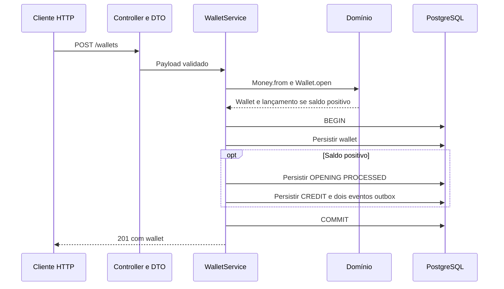

# Arquitetura

Este documento descreve implementação atual, não arquitetura-alvo do desafio. [Enunciado](README_TECHNICAL_CHALLENGE.md): requisitos. [PROGRESS](PROGRESS.md): cobertura e pendências. [Glossário](GLOSSARY.md): linguagem do domínio. Decisões e alternativas: ADRs vinculados abaixo.

## Mapa do código

| Área | Arquivos | Responsabilidade |
|---|---|---|
| Bootstrap | `src/main.ts` | Inicializa ORM/HTTP; encerra HTTP antes do pool em SIGINT/SIGTERM |
| Transporte e DI | `src/app.ts`, `src/*dto.ts`, `src/domain-error.filter.ts` | Três rotas, validação estrutural e tradução de erros conhecidos |
| Caso de uso e leitura | `src/wallet-service.ts` | Abertura atômica, reidratação de wallet e consulta keyset do ledger |
| Domínio | `src/domain/` | Money, Wallet, WalletLedgerEntry e eventos de abertura; sem NestJS/ORM |
| Persistência | `src/persistence/*record.ts`, `config.ts` | EntitySchema e configuração do MikroORM |
| Schema | `src/persistence/migrations/` | Constraints, FKs, trigger append-only e índices versionados |
| Verificação | `tests/domain/`, `tests/integration/` | Invariantes, constraints, atomicidade e fronteira HTTP com PostgreSQL real |

## Abertura de wallet

Falha antes do commit desfaz todas as escritas. `persistAndFlush` envia SQL dentro da transação, não antecipa commit. Abertura zero persiste somente wallet; ambas começam em versão 1. OPENING é interna, sem IDs fictícios de provedor, rodada ou jogo. Único estado de transação persistido neste estágio: OPENING/PROCESSED.

Unicidade `(player_id, currency)` arbitra aberturas concorrentes no PostgreSQL; duplicata retorna 409. Isso não é idempotência de apostas: reenvio não reproduz resultado original. Nenhum publisher consome a outbox neste estágio.

## Garantias e limites

- Dinheiro: centavos `bigint` no domínio; `numeric(30,2)` na persistência, lido como string. Limite SQL: 28 dígitos inteiros; overflow falha sem commit parcial. Nunca converter dinheiro para `number`.
- Domínio encapsula estado; factories criam e `rehydrate` reconstrói sem reaplicar transições. Validação HTTP não substitui invariantes do domínio.
- Banco protege saldo não negativo, unicidade, aritmética do ledger e consistência de identidade/moeda por FKs compostas. Trigger rejeita UPDATE, DELETE e TRUNCATE do ledger. Administrador capaz de remover trigger/schema não está contido por essa proteção.
- Correspondência saldo/ledger depende do caso de uso transacional; schema não promete impedir toda escrita administrativa arbitrária. Separação entre usuário de migrations e aplicação ainda é necessária antes de exposição real.
- Sem lock global. Controle de concorrência de movimentações por wallet ainda não implementado; concorrência de abertura não comprova segurança de BET/WIN/reversões ou três instâncias financeiras.
- Eventos persistidos: `WagerTransactionProcessed` e `WalletBalanceChanged`, com envelope versionado e MoneyProps. Persistência não comprova publicação, retry ou recuperação de publisher.

## Consultas e paginação

Wallet é lida por ID e reidratada. Ledger verifica existência da wallet e lê por `(created_at, id)` crescente. Cursor base64url canônico aponta para lançamento persistido da mesma wallet; PostgreSQL compara timestamp integral, sem passagem por `Date` para retomar página. Resposta preserva timestamp textual com offset e precisão disponível.

Keyset evita deslocamento de linhas existentes; **não é snapshot**. Linhas novas posteriores à âncora podem aparecer; inserções retroativas anteriores exigem nova travessia. Cursor é opaco, não secreto, credencial ou mecanismo de autorização. Contrato detalhado e exemplos: [Postman](docs/postman/README.md).

## Falhas HTTP

| Status | Códigos / comportamento |
|---|---|
| 400 | `INVALID_WALLET_PAYLOAD`, `INVALID_IDENTITY`, `INVALID_AMOUNT`, `INVALID_CURRENCY`, `INITIAL_BALANCE_NEGATIVE`, `INVALID_LEDGER_QUERY` |
| 404 | `WALLET_NOT_FOUND` |
| 409 | `WALLET_ALREADY_EXISTS` |
| 500 | Falha inesperada: resposta genérica do NestJS, sem SQL/credenciais |

Erros conhecidos retornam `{ "code": "..." }`. DTO rejeita campos extras, estruturas inválidas e dinheiro não textual, sem conversão implícita; falha estrutural precede formato. Apenas constraint de unicidade player/moeda é traduzida para duplicata. Outras falhas não viram 400/409. Taxonomia de erros transitórios de operações financeiras ainda pendente.

## Decisões

[Índice com rastreabilidade para requisitos](DECISIONS.md). D-001–D-005 foram migradas para ADR-0001–ADR-0005; status e limites preservados. Os ADRs são fonte das justificativas, alternativas e consequências.

## Ainda não entregue

Apostas e máquina de estados, reversões, referências fora de ordem, replay persistente e hash canônico, inbox/SQS, publishers concorrentes, retry/DLQ, reconciliação, health, métricas e logs estruturados permanecem em [PROGRESS](PROGRESS.md). Não há promessa de transições ou falhas desses fluxos no comportamento atual.

API é local e sem autenticação. Decisão final de omissão/IdP e ponto de extensão exigidos pelo enunciado ainda pendentes; bind em loopback não os substitui. Shutdown atual fecha HTTP e ORM, sem consumer, ack ou tratamento de visibilidade.

Setup, migrations e riscos de reversão: [README](README.md). Resultados executados e limites das provas: [evidências](docs/verification.md).

## Referências consultadas

- [MikroORM 6.6 EntitySchema](https://mikro-orm.io/docs/6.6/entity-schema): mapeamento sem decorators no domínio.
- [MikroORM 6.6 migrations](https://mikro-orm.io/docs/6.6/migrations): execução programática e reversão.
- [NestJS controllers](https://docs.nestjs.com/controllers): rotas, serialização e códigos padrão 201/200; implementação usa APIs presentes em 11.1.16.
- [Bun/NestJS metadata](https://github.com/oven-sh/bun/blob/main/test/integration/nest/nest_metadata.test.ts): suporte a decorators; compatibilidade com Bun 1.3.14 comprovada executando HTTP real, não inferida do branch main.
- [MikroORM 6.6 transações](https://mikro-orm.io/docs/6.6/transactions): transação explícita inclui Unit of Work e SQL customizado; flush interno não antecipa commit externo.
- [PostgreSQL 17 constraints](https://www.postgresql.org/docs/17/ddl-constraints.html): CHECK para aritmética local, UNIQUE e FKs para relações.
- [PostgreSQL 17 trigger functions](https://www.postgresql.org/docs/17/plpgsql-trigger.html): exceção aborta UPDATE/DELETE/TRUNCATE de auditoria.
- [NestJS validation](https://docs.nestjs.com/techniques/validation): DTOs, whitelist, `exceptionFactory` e rejeição de campos extras; APIs verificadas com NestJS 11.1.16.
- [NestJS exception filters](https://docs.nestjs.com/exception-filters): filtro centralizado com `BaseExceptionFilter` preserva tratamento genérico de falhas inesperadas.
- [Bun Docker](https://bun.sh/guides/ecosystem/docker): imagem oficial, instalação com lockfile e execução do código-fonte; projeto fixa versão em vez da tag genérica do exemplo.
- [MikroORM 6.6 Unit of Work](https://mikro-orm.io/docs/6.6/unit-of-work): persistência e flush não substituem fronteira transacional.
- [NestJS validation](https://docs.nestjs.com/techniques/validation): consulta via Context7 para `ValidationPipe`, whitelist e `exceptionFactory`; compatibilidade comprovada no NestJS 11.1.16 por HTTP real. Nest Boost MCP inspecionou rotas e DI existentes e confirmou nova rota em processo novo; servidor persistente anterior manteve snapshot antigo.